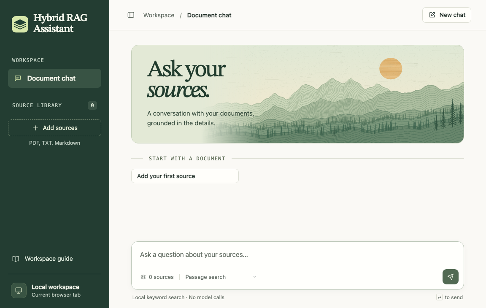
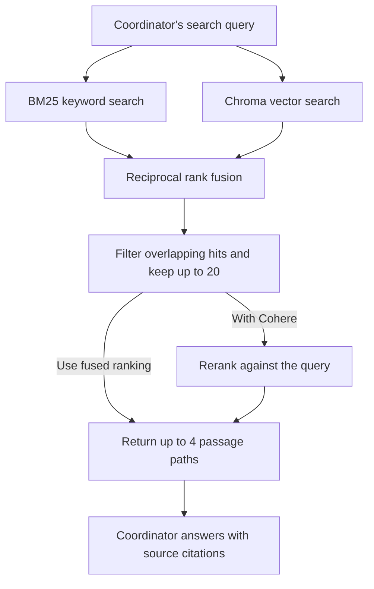

# Hybrid RAG Assistant

Ask questions across PDFs, text files, and Markdown notes, then open the passages behind the answer. The assistant combines BM25 keyword search with Chroma vector search so it can find both an exact term and a passage that expresses the same idea in different words. PDF results retain their filename and page number.



## Quick start

From a machine with Python 3.12+ and [uv](https://docs.astral.sh/uv/), clone the repository and start the web app.

```sh
git clone https://github.com/Karim-mans/hybrid-rag-assistant.git
cd hybrid-rag-assistant
uv run --locked hybrid-rag-assistant
```

Open <http://127.0.0.1:8765> and select **Add sources**. You can upload text-based PDFs or UTF-8 `.txt` and `.md` files.

| Mode | When to use it | Setup |
| --- | --- | --- |
| **Passage search** | Find a name, figure, or phrase and open the matching excerpts. | Runs locally without an API key. |
| **Agent chat** | Ask a question in your own words or compare evidence across documents. The assistant writes an answer with citations. | Set `OPENAI_API_KEY` in a `.env` file in the project root and restart the app. |

For a first search, upload this `README.md`, select **Passage search**, and enter `reciprocal rank fusion`. With **Agent chat** enabled, try uploading two editions of a report and asking *“What changed in the forecast between these editions? Cite the page from each report.”*

## How Agent chat finds evidence

The indexer splits each document into overlapping passages and preserves PDF page numbers. For each search, the coordinator asks the retrieval tool to rank passages from the active documents.



Each search method can nominate up to 50 passages. Reciprocal rank fusion combines their positions, giving passages that rank highly in both lists a boost. With a Cohere key, the reranker scores the shortlist against the query and selects the final passages.

For a simple lookup, the coordinator reads the first passage and can answer immediately. Its prompt allows one focused follow-up search for missing evidence and asks it to identify any remaining gaps. For independent parts of a question, it can ask up to three passage analysts to work in parallel. The web app shows the answer alongside the retrieved excerpts so you can check the wording yourself.

## Configuration and storage

On a fresh clone, copy [`.env.example`](.env.example) to `.env`, fill in the keys for the features you want, and restart the app. If you already have a `.env` file, edit it directly.

| Setting | Purpose |
| --- | --- |
| `OPENAI_API_KEY` | Enables Agent chat. OpenAI embeds new passages and search queries and, by default, generates answers from the question and retrieved evidence. |
| `COHERE_API_KEY` | Enables optional reranking. Cohere receives the search query and up to 20 candidate passages. |
| `RAG_CHAT_MODEL` | Selects the chat model used by the coordinator and its analysts. |
| `RAG_CHROMA_DIR` | Sets the local Chroma directory. Defaults to `data/chroma/` under the directory where the app starts. |

The current browser tab keeps its sources and conversation in session storage. Chroma caches passage text and embeddings on disk for reuse. Removing a source excludes it from future searches in that workspace while its cached passages stay on disk.

## Working with the code

| To explore | Start here |
| --- | --- |
| PDF extraction and passage splitting | [filereader.py](src/langchain_chatbot/filereader.py) · [indexing.py](src/langchain_chatbot/indexing.py) |
| Search, fusion, reranking, and passage paths | [hybrid_search.py](src/langchain_chatbot/hybrid_search.py) · [tools.py](src/langchain_chatbot/tools.py) |
| Agent decisions and instructions | [agent.py](src/langchain_chatbot/agent.py) · [prompts.py](src/langchain_chatbot/prompts.py) |
| Web app and local keyword search | [web.py](src/langchain_chatbot/web.py) · [browser UI](src/langchain_chatbot/static/) |

Ask about a PDF from the terminal with the same Agent chat settings.

```sh
uv run --locked python -m langchain_chatbot.agent report.pdf -q "Which assumptions drive the forecast?"
```

Run the offline tests for rank fusion, index reuse, source isolation, and citation handling.

```sh
uv run --locked python -m unittest discover -s tests -v
```

Inspired by the [RAG LangChain tutorial](https://github.com/Mohamad-Hachem/RAG_LangChain).
