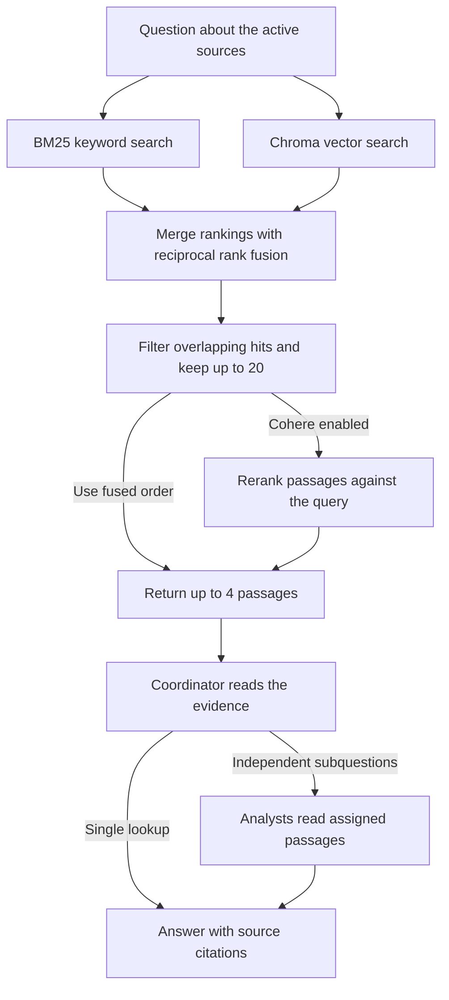

# Hybrid RAG Assistant

A retrieval-augmented generation (RAG) app for asking questions about PDFs, text files, and Markdown notes. It combines keyword and semantic search to find evidence for an answer. Open a retrieved passage to check the wording and, for text-based PDFs, read the text of the cited page.

## Try it locally

With Python 3.12+ and [uv](https://docs.astral.sh/uv/) installed, run this from the project directory.

```sh
uv run --locked hybrid-rag-assistant
```

Open <http://127.0.0.1:8765>. Select **Passage search** and ask **“How do beavers change rivers?”** The included field notes contain a passage about dams slowing water and reconnecting a stream to its floodplain. Open the passage to read it in context. To use a different port, add `--port 8766` to the command.

## Two ways to ask

| Mode | What you get | What you need |
| --- | --- | --- |
| **Passage search** | Excerpts ranked by matching words. The search runs on your computer. | Your documents or the included sample |
| **Agent chat** | A written answer grounded in retrieved passages, with source citations. | An OpenAI API key |

To enable **Agent chat**, set `OPENAI_API_KEY` in a `.env` file in the project directory and restart the server. OpenAI receives text for embeddings and the questions and retrieved evidence used to write answers. You can select a chat model with `RAG_CHAT_MODEL`. Adding `COHERE_API_KEY` enables a reranker that sends the search query and up to 20 candidate passages to Cohere.

## How Agent chat answers a question

The indexer splits each source into overlapping passages. **BM25** looks for words from the query, which helps with names and exact terms. **Chroma** stores OpenAI embeddings and finds passages with similar meaning, even when the wording differs.



**Reciprocal rank fusion (RRF)** uses each passage’s position in both result lists. A passage that ranks well in both gets a boost. The coordinator can answer a straightforward question as soon as one passage supports it. For a specific missing fact, its instructions allow one focused follow-up search. For independent questions that need different passages, it can delegate to analysts and combine their findings. If the evidence is incomplete, the prompt asks it to say what is missing.

## Where documents are stored

The web app and PDF command cache passage text and embeddings in `data/chroma/` under the directory where you start them. Reopening the same document reuses its stored embeddings. Set `RAG_CHROMA_DIR` to an absolute path to share the cache across working directories.

The browser tab keeps its source list and conversation in session storage. Removing a source excludes it from future searches in that workspace. Its cached passages stay on disk.

## Command line

Ask Agent chat about one or more PDFs directly from the terminal.

```sh
uv run --locked python -m langchain_chatbot.agent notes.pdf -q "What are the main findings?"
```

Run the offline tests for hybrid retrieval, Chroma reuse, and passage citations.

```sh
uv run --locked python -m unittest discover -s tests -v
```

Hybrid RAG Assistant was inspired by the [RAG LangChain tutorial](https://github.com/Mohamad-Hachem/RAG_LangChain).
